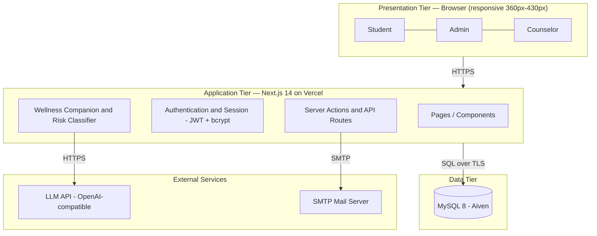
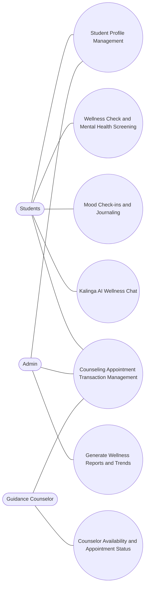
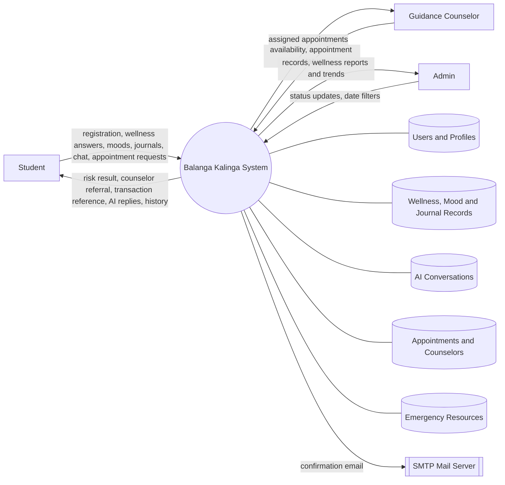
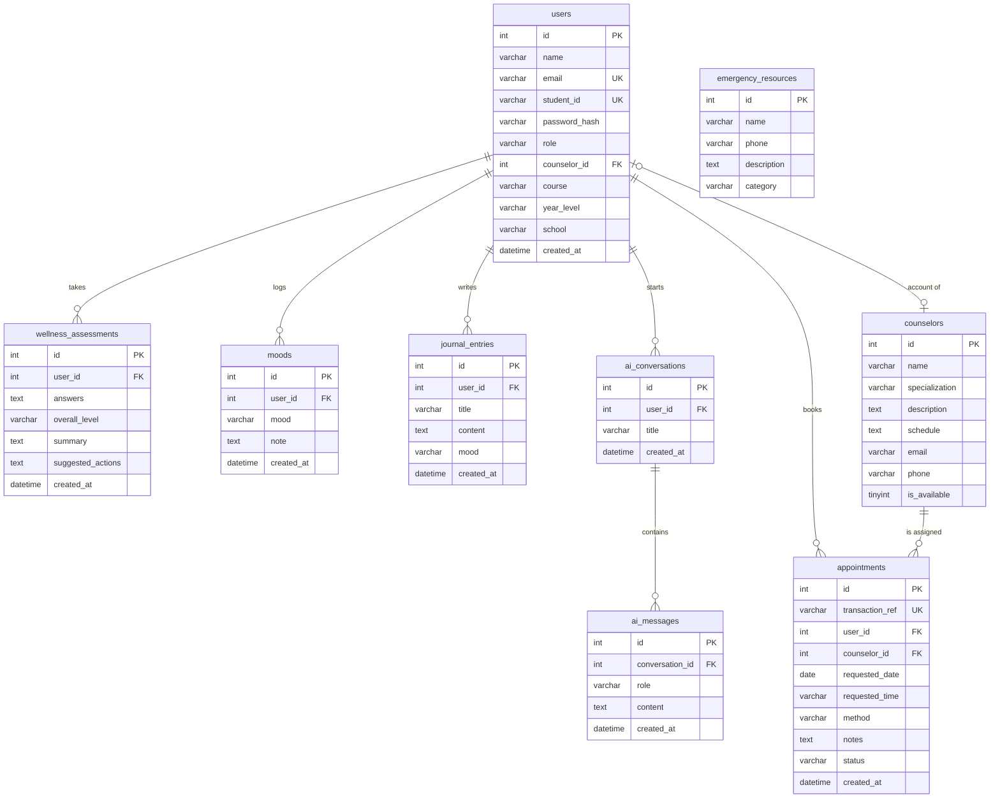
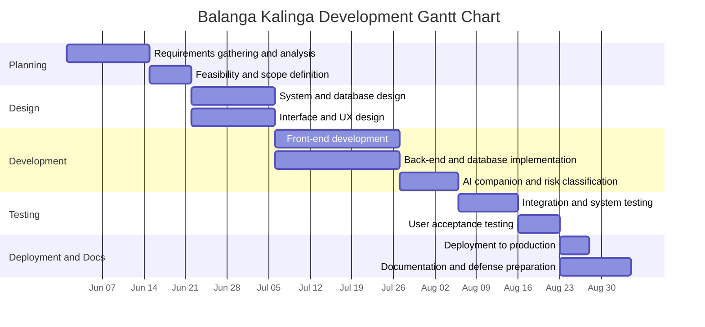

# CHAPTER 3
## PROJECT DESIGN AND DEVELOPMENT

This chapter presents the design, development, operation, testing, and evaluation of the **Balanga Kalinga: Web-Based Student Wellness Assessment and Counseling Management System**. It describes the system architecture and diagrams, the database design and entity-relationship model, the data dictionary, the project development schedule, the procedures for operating and testing the system, and the plan for evaluating its quality and acceptability.

The system is a web application built with **Next.js 14 (React 18)** for the user interface and server logic, **MySQL 8** deployed on a managed cloud host (Aiven) for data storage, **JSON Web Token (JWT)** sessions with **bcrypt** password hashing for authentication, **Nodemailer over SMTP** for email notifications, and a **Large Language Model (LLM) through an OpenAI-compatible API** for the wellness companion. It serves three user roles — **student**, **counselor**, and **admin** — through a single role-aware interface.

---

## 3.1 Project Design

### 3.1.1 Diagrams

The design of the system is expressed through a set of standard software engineering diagrams. Together they show how the system is structured, who uses it, and how data moves through it.

**a. System Architecture**

Balanga Kalinga follows a three-tier client–server architecture. The presentation and application tiers are combined in the Next.js application, which renders the interface on the server and handles requests through server actions and route handlers. The data tier is a managed MySQL database, and the system integrates two external services: an LLM API for the AI wellness companion and an SMTP mail server for registration confirmation emails.

*Figure 3.1. System architecture of Balanga Kalinga.*

**b. Use-Case Diagram**

The use-case diagram identifies three actors — **Students**, **Admin**, and **Guidance Counselor** — and the functions each performs. Students manage their profile, take the wellness check, keep mood and journal entries, talk to the AI companion, and book counseling appointments. The Guidance Counselor manages appointment status and personal availability. The Admin manages records and generates wellness reports.

*Figure 3.2. Use-case diagram of Balanga Kalinga.* See `docs/balanga-kalinga-use-case.svg` for the formatted version.

**c. Context (Data Flow) Diagram**

The context diagram shows the system as a single process exchanging data with its external entities and stores.

*Figure 3.3. Context (data flow) diagram.*

---

### 3.1.2 Database Design

The database is a **relational database managed by MySQL 8** and hosted on Aiven, accessed over an encrypted (TLS) connection. It uses the **InnoDB** storage engine to support foreign keys and transactions, and the **utf8mb4** character set to allow full Unicode storage.

**Design principles applied**

1. **Single sign-on table.** All accounts — students, counselors, and administrators — are stored in one `users` table distinguished by the `role` column. This keeps authentication logic in one place and avoids duplication.
2. **Referential integrity.** Child records carry foreign keys to their parent. Student-owned records use `ON DELETE CASCADE` so that deleting a user removes their personal data, preventing orphaned rows.
3. **Unique identity.** The `email` and `student_id` columns are unique so no two accounts collide. `counselor_id` in `users` is unique so exactly one login maps to one counselor profile.
4. **Normalization.** Tables are normalized to the third normal form (3NF): each table stores facts about one entity, repeated groups are separated into their own tables (`ai_messages`, `journal_entries`, `moods`), and no non-key attribute depends on another non-key attribute.
5. **Transaction integrity for appointments.** Each appointment carries a unique `transaction_ref` as a non-repudiable record of the request. A composite index on `(counselor_id, requested_date, requested_time, status)` supports the application-level rule that prevents double-booking the same counselor, date, and time while the status is `pending` or `approved`.
6. **Automatic provisioning.** Tables are created by the application on first use if they do not yet exist; the design never drops existing data.

**Table summary**

| No. | Table | Purpose | Primary Key |
|-----|-------|---------|-------------|
| 1 | `users` | Accounts for all roles | `id` |
| 2 | `counselors` | Counselor profiles and availability | `id` |
| 3 | `wellness_assessments` | Wellness check results and AI summaries | `id` |
| 4 | `moods` | Daily mood check-ins | `id` |
| 5 | `journal_entries` | Private student journal entries | `id` |
| 6 | `ai_conversations` | AI companion chat sessions | `id` |
| 7 | `ai_messages` | Individual messages within a chat | `id` |
| 8 | `appointments` | Counseling appointment transactions | `id` |
| 9 | `emergency_resources` | Crisis hotlines and support offices | `id` |

**Access roles in the database**

| Role | Scope of access |
|------|-----------------|
| `student` | Own profile, own wellness, mood, journal, chat, and appointment records |
| `counselor` | Only appointments assigned to their own `counselor_id`; own availability |
| `admin` | All users and appointments; wellness reports and trends |

---

### 3.1.3 Entity-Relationship Model

The entity-relationship model identifies the entities, their attributes, and the relationships between them. The system has **nine entities**. The `users` entity is the central parent of all student-owned records. The `counselors` entity is referenced by `users` (one login per counselor) and by `appointments`.

**Entities and key attributes**

- **users** — `id` (PK), name, email (unique), student_id (unique), password_hash, role, counselor_id (FK, unique), course, year_level, school, created_at.
- **counselors** — `id` (PK), name, specialization, description, schedule, email, phone, is_available.
- **wellness_assessments** — `id` (PK), user_id (FK), answers, overall_level, summary, suggested_actions, created_at.
- **moods** — `id` (PK), user_id (FK), mood, note, created_at.
- **journal_entries** — `id` (PK), user_id (FK), title, content, mood, created_at.
- **ai_conversations** — `id` (PK), user_id (FK), title, created_at.
- **ai_messages** — `id` (PK), conversation_id (FK), role, content, created_at.
- **appointments** — `id` (PK), transaction_ref (unique), user_id (FK), counselor_id (FK), requested_date, requested_time, method, notes, status, created_at.
- **emergency_resources** — `id` (PK), name, phone, description, category.

**Relationships and cardinality**

| Relationship | Cardinality | Description |
|--------------|-------------|-------------|
| users — wellness_assessments | 1 : M | One student takes many wellness checks. |
| users — moods | 1 : M | One student logs many moods. |
| users — journal_entries | 1 : M | One student writes many journal entries. |
| users — ai_conversations | 1 : M | One student holds many chat sessions. |
| users — appointments | 1 : M | One student books many appointments. |
| ai_conversations — ai_messages | 1 : M | One chat session contains many messages. |
| counselors — appointments | 1 : M | One counselor is assigned many appointments. |
| users — counselors | 1 : 1 | One counselor profile maps to one login account. |
| emergency_resources | — | Standalone reference data; no foreign key. |

*Figure 3.4. Entity-relationship model of Balanga Kalinga.* See `docs/balanga-kalinga-erd-full.svg` for the formatted diagram.

---

### 3.1.4 Data Dictionary

The data dictionary defines every table and field in the database, including data types, constraints, and descriptions.

#### Table 1. `users`
Stores the login accounts of all students, counselors, and administrators.

| Field | Data Type | Constraint | Description |
|-------|-----------|------------|-------------|
| id | INT | PK, AUTO_INCREMENT | Unique account identifier. |
| name | VARCHAR(120) | NOT NULL | Full name of the user. |
| email | VARCHAR(190) | NOT NULL, UNIQUE | Sign-in email address. |
| student_id | VARCHAR(40) | UNIQUE, NULL | School-issued student number (students only). |
| password_hash | VARCHAR(255) | NOT NULL | Bcrypt hash of the password. |
| role | VARCHAR(20) | NOT NULL, DEFAULT 'student' | `student`, `counselor`, or `admin`. |
| counselor_id | INT | UNIQUE, NULL, FK → counselors.id | Links a counselor account to its profile. |
| course | VARCHAR(120) | DEFAULT '' | Degree program. |
| year_level | VARCHAR(40) | DEFAULT '' | Year level. |
| school | VARCHAR(120) | DEFAULT '' | School or department. |
| created_at | DATETIME | DEFAULT CURRENT_TIMESTAMP | Date and time the account was created. |

#### Table 2. `counselors`
Stores the profile and availability of each guidance counselor.

| Field | Data Type | Constraint | Description |
|-------|-----------|------------|-------------|
| id | INT | PK, AUTO_INCREMENT | Unique counselor identifier. |
| name | VARCHAR(120) | NOT NULL | Counselor's full name. |
| specialization | VARCHAR(120) | NOT NULL | Area of specialization. |
| description | TEXT | NOT NULL | Short description of the counselor. |
| schedule | TEXT | NOT NULL | Available schedule. |
| email | VARCHAR(190) | NULL | Contact email used for the account. |
| phone | VARCHAR(40) | NULL | Contact number. |
| is_available | TINYINT(1) | NOT NULL, DEFAULT 1 | 1 = available, 0 = unavailable. |

#### Table 3. `wellness_assessments`
Stores each wellness check, its answers, computed risk level, and AI-generated summary.

| Field | Data Type | Constraint | Description |
|-------|-----------|------------|-------------|
| id | INT | PK, AUTO_INCREMENT | Unique assessment identifier. |
| user_id | INT | NOT NULL, FK → users.id (CASCADE) | Student who took the check. |
| answers | TEXT | NOT NULL | JSON array of the 10 item responses (1–5). |
| overall_level | VARCHAR(40) | NOT NULL | `low`, `moderate`, or `high`. |
| summary | TEXT | NOT NULL | Plain-language result summary. |
| suggested_actions | TEXT | NOT NULL | JSON array of recommended actions. |
| created_at | DATETIME | DEFAULT CURRENT_TIMESTAMP | Date and time of the check. |

#### Table 4. `moods`
Stores daily mood check-ins.

| Field | Data Type | Constraint | Description |
|-------|-----------|------------|-------------|
| id | INT | PK, AUTO_INCREMENT | Unique mood entry identifier. |
| user_id | INT | NOT NULL, FK → users.id (CASCADE) | Student who logged the mood. |
| mood | VARCHAR(30) | NOT NULL | Selected mood label. |
| note | TEXT | NULL | Optional note. |
| created_at | DATETIME | DEFAULT CURRENT_TIMESTAMP | Date and time logged. |

#### Table 5. `journal_entries`
Stores private journal entries written by students.

| Field | Data Type | Constraint | Description |
|-------|-----------|------------|-------------|
| id | INT | PK, AUTO_INCREMENT | Unique entry identifier. |
| user_id | INT | NOT NULL, FK → users.id (CASCADE) | Author of the entry. |
| title | VARCHAR(200) | DEFAULT '' | Entry title. |
| content | TEXT | NOT NULL | Entry body. |
| mood | VARCHAR(30) | DEFAULT 'okay' | Mood tag for the entry. |
| created_at | DATETIME | DEFAULT CURRENT_TIMESTAMP | Date and time written. |

#### Table 6. `ai_conversations`
Stores AI companion chat sessions.

| Field | Data Type | Constraint | Description |
|-------|-----------|------------|-------------|
| id | INT | PK, AUTO_INCREMENT | Unique conversation identifier. |
| user_id | INT | NOT NULL, FK → users.id (CASCADE) | Student who owns the conversation. |
| title | VARCHAR(200) | DEFAULT 'Talk with Kalinga AI' | Conversation title. |
| created_at | DATETIME | DEFAULT CURRENT_TIMESTAMP | Date and time started. |

#### Table 7. `ai_messages`
Stores the individual messages in an AI conversation.

| Field | Data Type | Constraint | Description |
|-------|-----------|------------|-------------|
| id | INT | PK, AUTO_INCREMENT | Unique message identifier. |
| conversation_id | INT | NOT NULL, FK → ai_conversations.id (CASCADE) | Parent conversation. |
| role | VARCHAR(20) | NOT NULL | `user` or `assistant`. |
| content | TEXT | NOT NULL | Message text. |
| created_at | DATETIME | DEFAULT CURRENT_TIMESTAMP | Date and time sent. |

#### Table 8. `appointments`
Stores counseling appointment transactions.

| Field | Data Type | Constraint | Description |
|-------|-----------|------------|-------------|
| id | INT | PK, AUTO_INCREMENT | Unique appointment identifier. |
| transaction_ref | VARCHAR(50) | NOT NULL, UNIQUE | Reference number, e.g. `BK-20261015-AB12CD34`. |
| user_id | INT | NOT NULL, FK → users.id (CASCADE) | Student who requested the appointment. |
| counselor_id | INT | NOT NULL, FK → counselors.id | Assigned counselor. |
| requested_date | DATE | NOT NULL | Preferred date. |
| requested_time | VARCHAR(20) | NOT NULL | Preferred time. |
| method | VARCHAR(30) | DEFAULT 'In-person' | `In-person` or `Online`. |
| notes | TEXT | NULL | Student's concern or note. |
| status | VARCHAR(30) | DEFAULT 'pending' | `pending`, `approved`, `declined`, `completed`, or `cancelled`. |
| created_at | DATETIME | DEFAULT CURRENT_TIMESTAMP | Date and time requested. |

*Index:* `(counselor_id, requested_date, requested_time, status)` — supports the double-booking check.

#### Table 9. `emergency_resources`
Stores crisis hotlines and support offices shown to students.

| Field | Data Type | Constraint | Description |
|-------|-----------|------------|-------------|
| id | INT | PK, AUTO_INCREMENT | Unique resource identifier. |
| name | VARCHAR(120) | NOT NULL | Name of the hotline or office. |
| phone | VARCHAR(40) | NOT NULL | Contact number. |
| description | TEXT | NOT NULL | Short description. |
| category | VARCHAR(30) | NOT NULL | `hotline`, `school`, or `emergency`. |

---

## 3.2 Project Development

The project was developed using an **incremental and iterative** approach. Requirements were gathered first, then the database and architecture were designed, after which the modules were built in order of dependency (authentication first, then wellness, then counseling, then reporting), with testing performed after every increment.

**Development tools and technologies**

| Layer | Technology |
|-------|------------|
| Front end | Next.js 14 (React 18), responsive CSS |
| Back end | Next.js server actions and API route handlers (Node.js) |
| Database | MySQL 8 (managed on Aiven) |
| Authentication | JSON Web Token sessions, bcrypt password hashing |
| AI service | LLM through an OpenAI-compatible API |
| Email | Nodemailer over SMTP |
| Hosting | Vercel |
| Version control | Git and GitHub |

### 3.2.1 Gantt Chart

The Gantt chart presents the schedule of activities across a sixteen-week development period. *(Adjust the dates to match your actual academic calendar.)*

**Schedule of activities**

| Phase | Activity | Duration |
|-------|----------|----------|
| 1 | Requirements gathering and analysis | Weeks 1–2 |
| 2 | Feasibility and scope definition | Week 3 |
| 3 | System and database design | Weeks 4–5 |
| 4 | Interface and UX design | Weeks 4–5 |
| 5 | Front-end development | Weeks 6–8 |
| 6 | Back-end and database implementation | Weeks 6–8 |
| 7 | AI companion and risk classification | Weeks 9–10 |
| 8 | Integration and system testing | Weeks 11–12 |
| 9 | User acceptance testing | Week 13 |
| 10 | Deployment to production | Week 14 |
| 11 | Documentation and defense preparation | Weeks 15–16 |

---

## 3.3 Operation and Testing Procedure

### 3.3.1 Operation Procedure

The system is operated entirely through a web browser on a computer or mobile phone. The general procedure is as follows.

**New student**
1. Open the system URL and choose **Create account**.
2. Enter Last Name, First Name, and Middle Initial, the student ID, email, course, year level, and school, then set a password.
3. Submit the form; the account is created and a confirmation email is sent.
4. Sign in using either the registered email or the student ID, together with the password.

**Wellness check**
1. Go to **Wellness Check**.
2. Answer the ten questions about the past four weeks using the scale *None of the time / A little / Some / Most / All of the time* (scored 1–5).
3. Submit the check. The system computes the total score, classifies the result as **low**, **moderate**, or **high**, and displays the summary and suggested actions.
4. If the result is **high**, the system displays a recommended guidance counselor with contact information for immediate follow-up.

**Kalinga AI companion**
1. Open **AI Chat** and type a message about mental health or wellbeing.
2. The companion replies with supportive, wellness-focused guidance.
3. If the topic is outside mental health and wellbeing, the companion replies exactly: *"Sorry I can't provide an answer for that. I am an AI Wellness companion focused on mental health and wellbeing."*

**Counseling appointment**
1. Open **Counseling**, choose a counselor, date, and time, select the method, and add a note.
2. Submit the request. The system generates a unique transaction reference number (for example `BK-20261015-AB12CD34`) and records the appointment as `pending`.
3. Track the appointment in the student's appointment history as its status changes.

**Guidance counselor**
1. Sign in at the **Staff login** page with the counselor email and password.
2. Review only the appointments assigned to them and update each status (`approved`, `declined`, `completed`, `cancelled`).
3. Toggle availability between **Available** and **Unavailable** for new requests.
4. Change the default temporary password.

**Administrator**
1. Sign in at the **Staff login** page with the administrator credentials.
2. Review students and appointments, update appointment statuses, and manage records.
3. Open **Reports**, choose a date range, and view or print the wellness summaries, risk distribution, and appointment details.

### 3.3.2 Testing Procedure

Testing was conducted at four levels: **unit testing**, **integration testing**, **system testing**, and **user acceptance testing (UAT)**.

- **Unit testing** — each function (password hashing, input validation, wellness scoring, transaction reference generation) was tested in isolation.
- **Integration testing** — modules were tested together: registration with email, wellness check with the AI classifier and the database, and appointment booking with the double-booking rule.
- **System testing** — the complete application was tested end to end on desktop and on mobile widths from 360px to 430px.
- **User acceptance testing** — students, counselors, and an administrator evaluated whether the system meets its intended purpose.

**Test cases and results**

| No. | Test Case | Expected Result | Actual Result | Status |
|-----|-----------|-----------------|---------------|--------|
| 1 | Register with valid details | Account created and confirmation email sent | Account created; email attempted | Passed |
| 2 | Register with an already-used email | Validation error shown | Error shown | Passed |
| 3 | Log in with valid email or student ID | Redirected to the correct dashboard | Redirected by role | Passed |
| 4 | Log in with wrong password | "Invalid credentials" message | Message shown | Passed |
| 5 | Wellness check with all answers | Score computed and risk level shown | Correct level shown | Passed |
| 6 | High-risk wellness result | Counselor with contact info displayed | Counselor displayed | Passed |
| 7 | AI chat with an off-topic question | Fixed scope reply shown | Exact scope message shown | Passed |
| 8 | AI chat with a wellness question | Supportive answer returned | Answer returned | Passed |
| 9 | Book an appointment | Unique transaction reference generated | Reference generated | Passed |
| 10 | Book the same counselor, date, and time twice | Second booking blocked | Booking blocked | Passed |
| 11 | Counselor login | Sees only their own appointments | Own appointments only | Passed |
| 12 | Counselor updates availability and status | Changes saved and reflected | Saved and reflected | Passed |
| 13 | Counselor opens an admin-only page | Access denied | Access denied | Passed |
| 14 | Admin generates a report for a date range | Summary and detail table shown | Correct data shown | Passed |
| 15 | Layout on a 360px-wide screen | No horizontal overflow; readable | Layout fits | Passed |

---

## 3.4 Evaluation Procedure

The system is evaluated on two dimensions: **software quality**, using the **ISO/IEC 25010** product quality model, and **user acceptability**, using a Likert-scale survey. This combination measures both technical conformance and how well the system serves its intended users.

### 3.4.1 Respondents

Evaluation is conducted with three groups of respondents:

| Group | Respondents | Number (example) |
|-------|-------------|------------------|
| End users | Students who used the wellness and counseling features | 30 |
| End users | Guidance counselors who used the dashboard | 3–5 |
| Technical evaluators | IT instructors or practitioners | 5 |

### 3.4.2 Evaluation Instrument

A validated questionnaire based on the eight ISO/IEC 25010 quality characteristics is used. Each item is rated on a five-point Likert scale:

| Scale | Meaning |
|-------|---------|
| 5 | Strongly Agree |
| 4 | Agree |
| 3 | Neutral |
| 2 | Disagree |
| 1 | Strongly Disagree |

| Characteristic | Sample item |
|----------------|-------------|
| Functional Suitability | The system performs the functions expected of a wellness and counseling system. |
| Performance Efficiency | The system responds quickly and handles requests without delay. |
| Compatibility | The system works correctly on different browsers and screen sizes. |
| Usability | The system is easy to learn and use without assistance. |
| Reliability | The system saves data correctly and is available when needed. |
| Security | Personal and wellness data are protected and visible only to authorized users. |
| Maintainability | The system can be updated and corrected with reasonable effort. |
| Portability | The system runs on the supported hosting environment without changes. |

### 3.4.3 Statistical Treatment

The weighted mean is used to determine the level of acceptability for each characteristic. The weighted mean is computed as:

**Weighted Mean = Σ (f × w) / N**

where *f* is the frequency of responses, *w* is the assigned weight (1–5), and *N* is the total number of respondents. The computed means are interpreted using the following range:

| Computed Mean | Interpretation |
|---------------|----------------|
| 4.21 – 5.00 | Very Highly Acceptable |
| 3.41 – 4.20 | Highly Acceptable |
| 2.61 – 3.40 | Acceptable |
| 1.81 – 2.60 | Slightly Acceptable |
| 1.00 – 1.80 | Not Acceptable |

### 3.4.4 Evaluation Procedure Steps

1. Prepare and validate the questionnaire with the adviser or a panel.
2. Orient the respondents on the purpose of the evaluation and, where required, obtain consent.
3. Let the respondents use the system to perform representative tasks (register, take the wellness check, chat, and book an appointment).
4. Administer the questionnaire and collect the responses.
5. Tabulate the responses, compute the weighted mean per characteristic, and interpret the results.
6. Summarize the findings, identify weak areas, and recommend improvements.

The results of the evaluation are presented and discussed in **Chapter 4**, together with the conclusions and recommendations.

---

## References

- International Organization for Standardization / International Electrotechnical Commission. *ISO/IEC 25010:2011 — Systems and software Quality Requirements and Evaluation (SQuaRE) — System and software quality models.*
- Next.js Documentation. Vercel. https://nextjs.org/docs
- MySQL 8.0 Reference Manual. Oracle Corporation. https://dev.mysql.com/doc/
